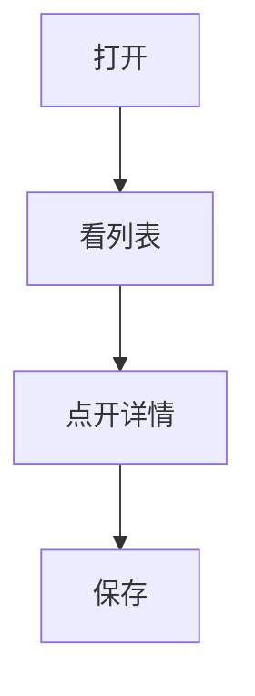

# 元对象功能梳理

拿到一个已经在用的标准元，回答：用来干什么，从哪打开，每个功能怎么用；并画一张页面流程图。

只读。不建表，不改过程，不给每个按钮单独出文件。

查库先读 `.AGENTS/skills/mes-db/SKILL.md`，只查当前这一套库。正式库走工作台标准拉取，不另写字段查询。这套库没有 `procedure`、工作台也拉不到过程时，用法写「这套库看不了过程，说不清怎么用」。

## 先看有没有旧稿

目标路径：

```text
tasks/{MCP名}/flow/{MetadataName}/survey.md
```

已有这份文件：直接读，用流程图和要点回答。不要重查库重写，除非用户要求重梳，或旧稿「说不清」且这次能补上。

没有才往下做。第一次必须写出流程图和关键操作要点。写在这个功能目录下，下次只读这份，不重梳。

取数和页面都走工作台同一套，规则在 `ops` 技能「页面和取数都是标准的」。先拉取 Table、DataObject、PageStyle、ValueList、MetaMethod，再分析 `library/{plant}/{命令}/object.json`。survey 不另抄字段表、按钮清单、表结构。下面的 SQL 只在测试库、标准拉取没有这一页时用，并在 survey 里注明。

## 做到哪算完

一份 UTF-8 文件，路径同上。

`{MCP名}` 用 `mes-db` 里这一套的英文名。多条候选还没让用户选定，或者 `PluginFileName` 不是 `Plugin Standard.dll` 时，不要写这个文件。

正文用使用说明，不罗列过程名。过程名只在说明后面用括号带上，方便回头查。必须有一张页面流程图。

## 先找到这个元对象

手上要有插件命令、元对象名或表名。都没有就问。`PluginCommand` 是定长，比较时两边都 `RTRIM`。查到多条就列出来问，不自己挑。

```sql
SELECT RTRIM(a.PluginCommand) AS PluginCommand, a.PluginName, a.PluginFileName, a.MetadataId,
       b.MetadataName, b.ParentMetadataId,
       b.TreeView, b.SubTreeView, b.MainView, b.MainSave, b.MainDelete, b.ObjectScript
FROM dbo.SysPlugIn AS a WITH (NOLOCK)
LEFT JOIN dbo.SysMetadata AS b WITH (NOLOCK) ON b.MetadataId = a.MetadataId
WHERE RTRIM(a.PluginCommand) = @PluginCommand;
```

只有元对象名时改查 `SysMetadata.MetadataName`。只有表名时，用 `SysObject.ObjectName` 连到 `SysMetadata.ObjectId`。

插件表没有这条，先看 `ParentMetadataId`，回到父元对象再查插件。父对象有插件，打开方式就写成：先开父插件，再进这个子页面。

`PluginFileName` 不是 `Plugin Standard.dll` 就停，告诉用户这不是标准元。

中文名取 `SysText.Text2`，`TextOwner = N'[Public Text]'`。界面中文和过程对不上时，以过程为准，并写明界面上叫什么。

## 再看有哪些功能

页面包括自己，以及 `ParentMetadataId` 等于本页的子页面。

字段和按钮从字段组查。`SysMetadataMethod` 没有 `MetadataId`。

```sql
SELECT f.FieldName, f.IsHidden, f.IsReadOnly, tx.Text2 AS FieldText
FROM dbo.SysMetadataFieldGroup AS g WITH (NOLOCK)
INNER JOIN dbo.SysMetadataField AS f WITH (NOLOCK) ON f.MetadataFieldGroupId = g.MetadataFieldGroupId
LEFT JOIN dbo.SysText AS tx WITH (NOLOCK) ON tx.TextModule = f.FieldName AND tx.TextOwner = N'[Public Text]'
WHERE g.MetadataId = @MetadataId;

SELECT m.MethodName, m.SQLDoMethod, tx.Text2 AS MethodText
FROM dbo.SysMetadataFieldGroup AS g WITH (NOLOCK)
INNER JOIN dbo.SysMetadataMethod AS m WITH (NOLOCK) ON m.MetadataFieldGroupId = g.MetadataFieldGroupId
LEFT JOIN dbo.SysText AS tx WITH (NOLOCK) ON tx.TextModule = m.MethodName AND tx.TextOwner = N'[Public Text]'
WHERE g.MetadataId = @MetadataId;
```

用 `procedure` 读非空的 `TreeView`、`MainView`、`MainSave`、`MainDelete` 和每个 `SQLDoMethod`。读的时候只抓三样：它维护哪张业务，人要先满足什么条件，点下去写成什么。

- 列表里能看见什么、谁看不见：看 `TreeView`
- 点开一条之后填什么：看 `MainView` 和能看见的字段
- 保存、删除会怎样，什么情况被拒绝：看 `MainSave`、`MainDelete`
- 每个按钮：界面上叫什么，什么时候点，点完发生什么

`ObjectScript` 非空时写「这个页面还有一段脚本，这次没展开」。

## 画一张流程图

放在「怎么用」后面。只画用户在界面上的动作，节点写界面叫法，不写过程名。

按这个顺序接，没有的步骤不要画：

1. 打开插件（子页面写先开父再进本页）。
2. 列表里看什么 / 筛什么（`TreeView`）。
3. 点开一条看详情（`MainView`）。
4. 保存 / 删除（过程为空就不要画）。
5. 主要按钮各一个节点（隐藏、看不懂的不画）。



上面只是形状。换成这个元对象实际有的步骤和按钮。只留一张，不为每个按钮另出图。

## 写成使用说明

```markdown
# {中文名}

库：{MCP名}。插件 {PluginCommand}。

用来干什么：{这个元对象维护什么业务，一两句}

怎么打开：{插件中文名。子页面写先开哪个父插件，再进这一页}

## 怎么用

1. 打开后列表里是什么，哪些记录能看见，哪些看不见。
2. 点开一条要填什么。
3. 保存时会检查什么，失败时是什么情况。
4. 删除时会怎样。

## 流程图

{一张 mermaid flowchart}

## 按钮

| 界面上叫 | 什么时候用 | 点下去做什么 |
|---|---|---|

## 说不清的
```

子页面各加一节「怎么用」和「按钮」。流程图仍只留一张，概括主路径。看不懂的放在最后，不猜。
