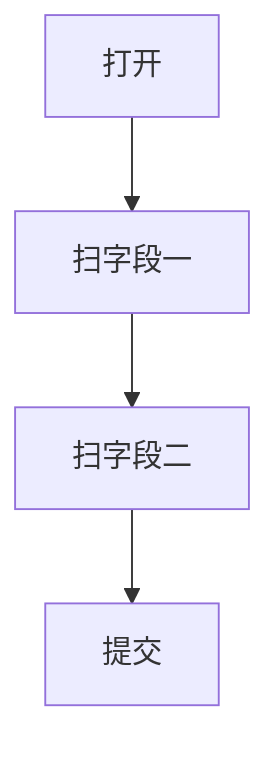

# 移动事务对象梳理

移动事务对象跑在 PDA（OrDroid）上。一个 PDA 插件可以挂多个 MobileObject，表现为同一次打开后的多个页面或页签，按 `MobileObjectSequence` 排序。

只读。不建表，不改移动事务对象，不改过程。

查库先读 `.AGENTS/skills/mes-db/SKILL.md`，只查当前这一套 MES 库，只用 `query` 和 `procedure`。这套库没有 `procedure` 时，过程部分写「这套库看不了过程，说不清怎么用」。

MES 库的这套表结构一致。表或列查不到时，停下告诉用户这是环境问题，不要自己改查别的表。

正式库走工作台标准拉取，不另写字段查询。`query_meta.ps1 -Action mobile` 和下面的 SQL 只在测试库、标准拉取没有这一页时用。

## 先看有没有旧稿

目标路径：

```text
tasks/{MCP名}/flow/{PluginCommand}/survey.md
```

已有这份文件：直接读，用流程图和要点回答。不要重查库重写，除非用户要求重梳，或旧稿「说不清」且这次能补上。

没有才往下做。第一次必须写出流程图和关键操作要点。写在这个功能目录下，下次只读这份，不重梳。

取数和页面都走工作台同一套，规则在 `ops` 技能「页面和取数都是标准的」。移动事务先拉取 PageStyle、ValueList、MetaMethod，再分析 `library/{plant}/{命令}/object.json` 里各页的方法和过程。survey 不另抄字段表。下面的 SQL 只在测试库、标准拉取没有这一页时用，并在 survey 里注明。

## 做到哪算完

一份 UTF-8 文件，路径同上。

`{MCP名}` 用 `mes-db` 里的英文名。一个插件下有多个 MobileObject 时，全部写进同一份，每个对象一节。必须有一张页面流程图。

判断是不是移动事务对象，看两处：`SysPlugIn.PluginFileName` 是 `PluginMESMobile.dll`，或者 `OrDroidPlugin` 的命令在 `OrDroid_MobileObject` 里能挂到 `MobileObject`。两处都对不上，不要写这个文件，直接告诉用户这不是移动事务对象。

## 先找到插件

手上要有 PDA 插件命令、移动事务对象名或界面名。都没有就问。`PluginCommand` 是定长，比较时两边都 `RTRIM`。

先查 PC 侧插件表：

```sql
SELECT RTRIM(a.PluginCommand) AS PluginCommand, a.PluginName,
       a.PluginParameter, RTRIM(a.PluginFileName) AS PluginFileName
FROM dbo.SysPlugIn AS a WITH (NOLOCK)
WHERE RTRIM(a.PluginCommand) = @PluginCommand;
```

没有，或文件名不是 `PluginMESMobile.dll`，再查 OrDroid 侧：

```sql
SELECT RTRIM(o.OrDroidPluginId) AS PluginId, RTRIM(o.OrDroidPluginCommand) AS PluginCommand,
       o.OrDroidPluginName AS PluginName, o.OrDroidPluginDescription AS PluginDescription,
       RTRIM(o.OrDroidPluginFileName) AS PluginFileName, o.IsHorizontal
FROM dbo.OrDroidPlugin AS o WITH (NOLOCK)
WHERE RTRIM(o.OrDroidPluginCommand) = @PluginCommand;
```

两边都没有就停。两边都有时都记下来；对象集合不一致时，以 OrDroid 配置的页面顺序为准，并在文件里注明另一处的差异。

`PluginParameter` 里的对象名写法是 `[MOBILETXN:移动事务对象名]`。

## 再确定有哪些移动事务对象

PC 侧插件：先用 `PluginParameter` 原文查参数映射，一个插件可以映射多个对象：

```sql
SELECT RTRIM(ParameterValue) AS ObjectName, ParameterValueEx, CreateDate
FROM dbo.SysParameter WITH (NOLOCK)
WHERE ParameterName = @PluginParameter
ORDER BY ParameterValueEx, CreateDate, ParameterId;
```

- 查到多行：同一插件的多个页面，逐个写，不挑。
- 一行都没有：从 `PluginParameter` 取 `[MOBILETXN:...]` 里的名称。

OrDroid 侧插件：直接查页面顺序：

```sql
SELECT c.MobileObjectSequence,
       RTRIM(m.MobileObjectId) AS ObjectId,
       m.MobileObjectName, m.MobileObjectDesc
FROM dbo.OrDroid_MobileObject AS c WITH (NOLOCK)
INNER JOIN dbo.MobileObject AS m WITH (NOLOCK)
        ON RTRIM(m.MobileObjectId) = RTRIM(c.MobileObjectId)
WHERE RTRIM(c.OrDroidPluginId) = @OrDroidPluginId
ORDER BY c.MobileObjectSequence, m.MobileObjectName;
```

用名称定位对象。先按名称精确匹配，没有再按描述匹配；命中多条就列出来问：

```sql
SELECT RTRIM(MobileObjectId) AS ObjectId, MobileObjectName, MobileObjectDesc,
       IsActivity, ColumnCount, FieldWidth, FieldSpace, MsgCount, AccessCode
FROM dbo.MobileObject WITH (NOLOCK)
WHERE RTRIM(MobileObjectName) = @ObjectName
   OR RTRIM(MobileObjectDesc) = @ObjectName;
```

## 再看这个页面有什么

字段（对象参数）：

```sql
SELECT RTRIM(MobileObjectParameterId) AS ParameterId, MobileObjectParameterName, DataType,
       ParameterSequence, IsValueListUsage, ValueList, LinkToValueListParameter,
       IsReadOnly, IsHidden, IsMustInput, ControlLine,
       IsGrid, IsPicture, IsSplitLine, DecimalPlace, AccessCode
FROM dbo.MobileObjectParameter WITH (NOLOCK)
WHERE RTRIM(MobileObjectId) = @ObjectId
ORDER BY ParameterSequence, MobileObjectParameterId;
```

按钮和自动动作：

```sql
SELECT RTRIM(MobileObjectMethodId) AS MethodId, MobileObjectMethodName, MethodSequence,
       SQLDoTxn, TxnParameter, RefreshGridParameter,
       IsHidden, IsBeforeRunningConfirm, PromptMessage,
       IsAutoRunWhenTabActive, IsPlaySound, IsGetGPS, AccessCode
FROM dbo.MobileObjectMethod WITH (NOLOCK)
WHERE RTRIM(MobileObjectId) = @ObjectId
ORDER BY MethodSequence, MobileObjectMethodId;
```

中文名取 `SysText.Text2`，`TextOwner = N'[Public Text]'`，`TextModule` 用参数名或方法名。

数据类型按这个读：

| `DataType` | 界面 |
|---|---|
| `C` | 文本 |
| `D` | 日期 |
| `B` | 勾选 |
| `I` | 整数 |

## 读过程

- `SQLDoTxn` 非空：用 `procedure` 读它，这就是按钮或提交真正做的事。
- `TxnParameter`：传给过程的参数名，按顺序对上字段。
- `RefreshGridParameter`：结果表回填到哪个参数（通常是页面上的网格）。
- `SQLDoTxn` 为空但按钮可见：多是客户端内置动作，比如清屏、返回、切页。按按钮名写，不要硬编业务含义。
- `IsBeforeRunningConfirm` 和 `PromptMessage`：点之前要不要确认，确认文案是什么。
- `IsAutoRunWhenTabActive`：进入这个页面就自动跑。
- 移动事务对象没有 `ObjectScript`，也没有第三方 DLL 入口；过程读不到就写「说不清」，不要从字段名猜业务。

## 画一张流程图

放在「怎么用」后面。只画用户在 PDA 上的动作，节点写界面叫法，不写过程名。

按这个顺序接，没有的步骤不要画：

1. 打开 PDA 功能（多页面时按 `MobileObjectSequence` 标顺序）。
2. 按扫描/填写顺序。
3. 点按钮或提交；自动跑的进入页动作写在打开之后。
4. 成功 / 失败提示（可并在提交节点上）。
5. 查询类页面：填条件 → 看结果表。



上面只是形状。换成这个 PDA 功能实际的字段和按钮。只留一张。多页面时一张图里标清页面顺序，不另出文件。

## 写成使用说明

```markdown
# {中文名}

库：{MCP名}。PDA 命令 {PluginCommand}（{PluginName}）。移动事务对象 {MobileObjectName}。

用来干什么：{这个页面在 PDA 上完成什么业务，一两句}

怎么打开：{PDA 客户端功能名}。{有多个页面时写清顺序；横屏/竖屏也照实写}

## 怎么用

1. 打开后先看到什么：哪些字段要扫/填，哪些隐藏，哪些只读或必填。
2. 按什么顺序操作，每一步检查什么。
3. 点按钮或提交后写什么业务，失败时是什么提示。
4. 权限、GPS 等限制。

## 流程图

{一张 mermaid flowchart}

## 字段

| 界面上叫 | 参数名 | 类型 | 必填 | 只读/隐藏 | 取值来源 |
|---|---|---|---|---|---|

## 按钮

| 界面上叫 | 什么时候用 | 点下去做什么 |
|---|---|---|

## 说不清的
```

- 一个插件有多个 MobileObject 时，每个对象重复「怎么用」「字段」「按钮」三节；流程图仍只留一张，概括主路径和页面顺序。
- 隐藏方法不进按钮表，放在「怎么用」里说明它什么时候被触发。
- 页面直接返回表格的（查询类 PDA），把结果列写进「怎么用」第 3 条。
- 看不懂的放最后，不猜。
