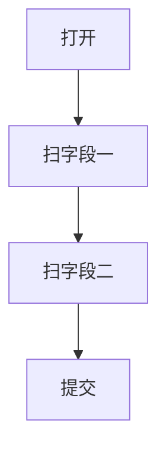

# 静态事务对象梳理

静态事务对象是 PC 客户端上的采集、扫描、打印界面。一个插件可以带多个事务对象，表现为同一次打开后的几个页签。

只读。不建表，不改事务对象，不改过程。

查库先读 `.AGENTS/skills/mes-db/SKILL.md`，只查当前这一套 MES 库，只用 `query` 和 `procedure`。这套库没有 `procedure` 时，过程部分写「这套库看不了过程，说不清怎么用」。

MES 库的这套表结构一致。表或列查不到时，停下告诉用户这是环境问题，不要自己改查别的表。

正式库走工作台标准拉取，不另写字段查询。`query_meta.ps1 -Action txn` 和下面的 SQL 只在测试库、标准拉取没有这一页时用。

## 先看有没有旧稿

目标路径：

```text
tasks/{MCP名}/flow/{PluginCommand}/survey.md
```

已有这份文件：直接读，用流程图和要点回答。不要重查库重写，除非用户要求重梳，或旧稿「说不清」且这次能补上。

没有才往下做。第一次必须写出流程图和关键操作要点。写在这个功能目录下，下次只读这份，不重梳。

取数和页面都走工作台同一套，规则在 `ops` 技能「页面和取数都是标准的」。静态事务先拉取 PageStyle、ValueList、MetaMethod，再分析 `library/{plant}/{命令}/object.json`。survey 不另抄字段表。下面的 SQL 只在测试库、标准拉取没有这一页时用，并在 survey 里注明。

## 做到哪算完

一份 UTF-8 文件，路径同上。

`{MCP名}` 用 `mes-db` 里的英文名。一个插件下有多个事务对象时，全部写进同一份，各占一节。必须有一张页面流程图。

插件不是 `PluginMESStaticTxn.dll` 时不要写这个文件，直接告诉用户这不是静态事务对象。

## 先找到插件

手上要有插件命令、事务对象名或界面名。都没有就问。`PluginCommand` 是定长，比较时两边都 `RTRIM`。

```sql
SELECT RTRIM(a.PluginCommand) AS PluginCommand, a.PluginName,
       a.PluginParameter, RTRIM(a.PluginFileName) AS PluginFileName,
       RTRIM(a.MetadataId) AS MetadataId
FROM dbo.SysPlugIn AS a WITH (NOLOCK)
WHERE RTRIM(a.PluginCommand) = @PluginCommand;
```

查到多条就列出来问，不自己挑。

`PluginParameter` 里带对象名和开关，常见的有：

| 标记 | 写法 |
|---|---|
| 对象名 | `[MESTXN:事务对象名]` |
| 不显示工具栏 | `[NoToolBar]` |
| 不做批号扫描 | `[NoLotScan]` |
| 不做规格检查 | `[NoSpecCheck]` |

还有 `[N]`、`[NL]`、`[Save]` 这类标记，原样记录，不下结论。

## 再确定是哪个事务对象

先用 `PluginParameter` 原文查参数映射，一个插件可以映射多个对象：

```sql
SELECT RTRIM(ParameterValue) AS ObjectName, ParameterValueEx, CreateDate
FROM dbo.SysParameter WITH (NOLOCK)
WHERE ParameterName = @PluginParameter
ORDER BY ParameterValueEx, CreateDate, ParameterId;
```

- 查到多行：这是同一插件的多个页签，逐个写，不挑。
- 一行都没有：从 `PluginParameter` 取 `[MESTXN:...]` 里的名称。

用名称定位对象：

```sql
SELECT RTRIM(MESTxnObjectId) AS ObjectId, MESTxnObjectName, MESTxnObjectDesc,
       IsActivity, MESTxnObjectType, ColumnCount,
       IsThirdDllUsage, ThirdDllFileName,
       DTxnSubmitTxn, DTxnSubmitParameter,
       IsDefaultMESTxn, IsStaticRun, IsUserUI, IsRunObjectScript,
       LEN(ISNULL(ObjectScript, '')) AS ScriptLength,
       AccessCode, SOPGroupId
FROM dbo.MESTxnObject WITH (NOLOCK)
WHERE RTRIM(MESTxnObjectName) = @ObjectName;
```

没有行就停，说明插件还在但对象名对不上。同一个名称查到多行也停，列出来问。

## 再看这个对象有什么

字段（对象参数）：

```sql
SELECT RTRIM(MESTxnObjectParameterId) AS ParameterId, TxnParameterName, DataType,
       ParameterSequence, IsValueListUsage, ValueList, LinkToValueListParameter,
       IsReadOnly, IsHidden, IsMustInput, ControlLine,
       IsGrid, IsPicture, IsSplitLine,
       DefaultValue, HiddenCondition, RegularExpression, AccessCode
FROM dbo.MESTxnObjectParameter WITH (NOLOCK)
WHERE RTRIM(MESTxnObjectId) = @ObjectId
ORDER BY ParameterSequence, MESTxnObjectParameterId;
```

按钮和自动动作：

```sql
SELECT RTRIM(MESTxnObjectMethodId) AS MethodId, MESTxnObjectMethodName, MethodSequence,
       SQLDoTxn, TxnParameter,
       IsHidden, IsBeforeRunningConfirm, PromptMessage,
       IsResetWhenDone, IsAutoRunWhenTabActive, IsPlaySound, AccessCode,
       LabelFileSP, LabelFileName, LabelCopies
FROM dbo.MESTxnObjectMethod WITH (NOLOCK)
WHERE RTRIM(MESTxnObjectId) = @ObjectId
ORDER BY MethodSequence, MESTxnObjectMethodId;
```

中文名取 `SysText.Text2`，`TextOwner = N'[Public Text]'`，`TextModule` 用参数名或方法名。

数据类型按这个读：

| `DataType` | 界面 |
|---|---|
| `C` | 文本 |
| `D` | 日期；`IsShowTime` 为真时带时间 |
| `B` | 勾选 |
| `I` | 整数 |

## 读过程和脚本

- `SQLDoTxn` 非空：用 `procedure` 读它。它通常就是按钮真正做的事。
- `SQLDoTxn` 为空但按钮可见：去 `ObjectScript` 里找 `ButtonClick("按钮名")`，业务过程可能写在脚本里。
- `DTxnSubmitTxn` 非空：提交时还会调用这个事务/过程，参数按 `DTxnSubmitParameter` 里点名的字段取值。
- `IsThirdDllUsage = 1`：逻辑在 `ThirdDllFileName` 里，SQL 看不到。只能按参数名和描述写，并写明「逻辑在第三方 DLL，这次没展开」。
- `IsRunObjectScript = 1` 且 `ObjectScript` 非空：读脚本。只抓这几样：
  - 扫什么、先扫哪个字段、焦点怎么跳；
  - 每步成功和失败条件，失败时弹什么提示；
  - 脚本里 `EXEC [dbo].[...]` 或 `GetSqlDataSet` 真正调的过程；
  - 脚本里维护的表格列（如批次清单）。

脚本可能有一两万字，只写行为，不贴代码。

## 画一张流程图

放在「怎么用」后面。只画用户在界面上的动作，节点写界面叫法，不写过程名。

按这个顺序接，没有的步骤不要画：

1. 打开插件（多页签时先画切到哪个页签）。
2. 按扫描/填写顺序：先扫什么，再扫什么。
3. 点提交或主按钮。
4. 成功 / 失败提示（失败可并在提交节点上，不另拆一串异常树）。
5. 打印入口单独节点（有的话）。



上面只是形状。换成这个事务对象实际的字段和按钮。只留一张。多页签时一张图里用子图或分支标清页签，不为每个页签另出文件。

## 写成使用说明

```markdown
# {中文名}

库：{MCP名}。插件 {PluginCommand}（{PluginName}）。事务对象 {MESTxnObjectName}。

用来干什么：{这个事务对象维护什么业务，一两句}

怎么打开：{MES 客户端里的插件中文名}。{有多个页签时写清顺序}。{有开关标记时照实写，例如不显示工具栏、不做批号扫描}

## 怎么用

1. 打开后界面是什么：哪些字段看得见，哪些隐藏，哪些只读或必填。
2. 按什么顺序操作：先选/扫什么，再扫什么，每一步检查什么。
3. 提交或点按钮后写什么业务，失败时是什么提示。
4. 权限、第三方 DLL 的限制。

## 流程图

{一张 mermaid flowchart}

## 字段

| 界面上叫 | 参数名 | 类型 | 必填 | 只读/隐藏 | 取值来源 |
|---|---|---|---|---|---|

## 按钮

| 界面上叫 | 什么时候用 | 点下去做什么 |
|---|---|---|

## 脚本和第三方

{脚本补了哪些行为；哪些逻辑在 DLL 里看不到；没有就删掉这一节}

## 说不清的
```

- 一个插件有多个事务对象时，每个对象重复「怎么用」「字段」「按钮」三节；流程图仍只留一张，概括主路径和页签切换。
- 隐藏方法不进按钮表，放在「脚本和第三方」里说明它什么时候被触发。
- 打印类字段非空时，在按钮说明里写清「打印什么标签」。
- 看不懂的放最后，不猜。
