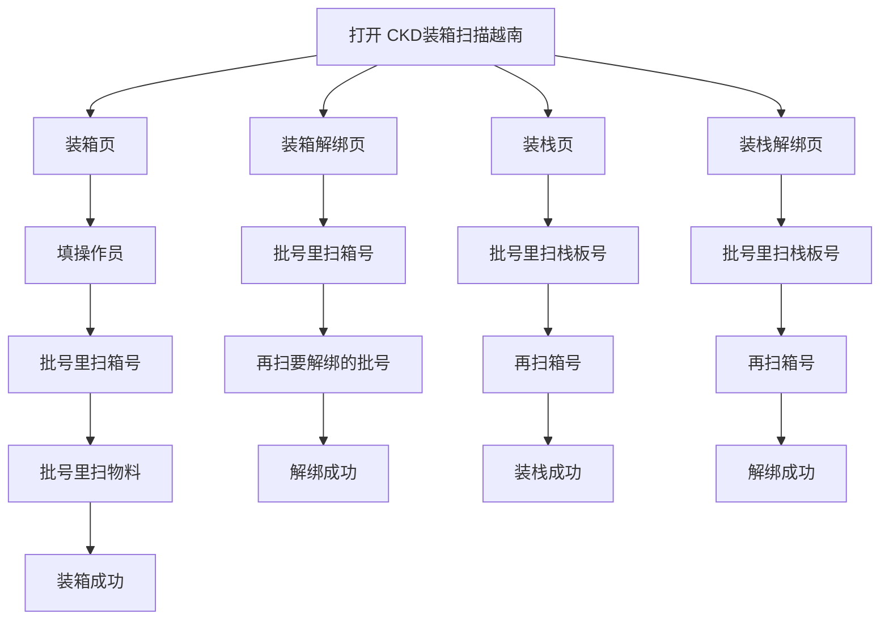

# CKD装箱扫描(越南)

库：jiban-mes-prod。PDA 命令 CKDYN（CKD装箱扫描(越南)）。竖屏。

PC 侧插件参数是 `[MOBILETXN:CKD装箱扫描(越南)]`，这个名字对不上移动事务对象名。实际页面以 OrDroid 为准，共 4 页，顺序 01 / 03 / 05 / 08。

用来干什么：越南 CKD 订单在 PDA 上装箱、从箱里解绑、把箱装上栈板、从栈板上解绑。

怎么打开：MES 菜单组「L9.KD Order」，用户组「TV SKD包装」或「TV 散件生产」，功能名「CKD装箱扫描(越南)」。四个页面按下面顺序排，没有单独的可见按钮，扫「批号」回车就提交。

界面以工作台为准：[基板 / CKDYN](http://127.0.0.1:3000/functions/jiban/CKDYN?view=style)，本地缓存 `library/jiban/CKDYN`。

## 怎么用

### 1. CKD 装箱（越南）

对象名 CKD Packing YN。把物料批号装进 CKD 箱。

1. 字段排版看工作台 PageStyle。操作员不是界面必填，但工号必须是在职人员，否则报「操作员工号无效」。订单号在页面上隐藏，扫到箱号后回写。
2. 先在「批号」扫 CKD 箱号。箱号有效时回写箱号，提示「获取箱号成功」。订单已手工完成则提示「订单状态为已完成，不允许装箱，请联系【GC1005】处理」。没扫箱就扫物料，提示「请先扫描箱号」。
3. 再在「批号」扫物料。以 R 开头按批号取库存，以 B 开头按送货外箱取库存。基板库存没有时，会尝试把总装库存转进来；转失败把原因直接提示出来，转完仍没有有效库存则提示检查。批号须属于该订单的仓库发货单（发料单或备料单）。不在发货单上的，只有有效合盘、且展开到最底层的原始盘都在本发货单上才放行，最多 10 层。然后写入装箱，按订单组件行分配已发数量，重算该箱净重和本箱已装数量。成功提示「装箱成功, 请扫描下一个物料!」，已扫数量更新，批号清空。
4. 常见失败：批号无效、非仓库发货单批号、仓库未发料、该批号已装箱、数量为 0、订单中无此组件、物料未全部展开、物料数量已变更、装箱数据错误请联系 IT、同一订单同一物料正在被别人装箱（提示已被锁定请重试）。料号 60101018091 不检查「仓库未发料」。异常时提示数据库错误原文。
5. 不取 GPS。没有单独权限码。

### 2. CKD装箱解绑(越南)

对象名 CKD BoxRelieve YN。把已经装进 CKD 箱的批号解出来。箱已经装栈时不能解。

1. 先在「批号」扫箱号。该箱已装栈，提示「扫描的箱号已经装栈，请先解绑栈板」。否则回写箱号和已扫数量，提示「获取箱号成功,请扫描批号解绑!」。
2. 再扫要解绑的条码。R 开头按批号，B 开头按库存外箱。批号无效、没有装箱、不属于当前箱、装箱分配数据对不上，都会拦住。通过后取消该箱里的这些批号，扣回已发数量，重算净重和剩余数量。提示「解绑成功!」，已扫数量更新。
3. 不取 GPS。没有确认框。

### 3. CKD通用装栈

对象名 CKD PalletScan。把已经装好的 CKD 箱扫到栈板上。

1. 先在「批号」扫栈板号。栈板有效则回写栈板号、订单号、已扫描箱数，提示「获取栈板成功,请扫描箱号!」。没扫栈板就扫箱，提示「栈板号无效，请先扫描有效的栈板号」。
2. 再扫箱号。箱必须存在、属于这个栈板的订单、并且还没装过栈。成功写入装栈记录，已扫描箱数加一，提示「装栈成功，请扫描下一箱!」。
3. 失败提示：箱号不存在、外箱不属于此订单、外箱已装栈板不允许重复装栈。
4. 不取 GPS。

### 4. CKD 装栈解绑

对象名 CKD PalletRelieve。把箱从栈板上解下来。

1. 先在「批号」扫已经装过箱的栈板号。回写栈板号和已扫描箱数，提示「获取栈板成功,请扫描箱号解绑!」。栈板上没有在用的箱，提示「栈板号无效，请先扫描有效的栈板号」。
2. 再扫箱号。这个箱当前不在任何栈板上，提示「扫描的箱号不属于该栈板」。在栈板上则把该栈板与该箱的装栈记录作废，已扫描箱数更新，提示「解绑成功!」。
3. 不取 GPS。

## 流程图

字段、按钮和只读状态以工作台 PageStyle、MetaMethod 为准，定义在 `library/jiban/CKDYN/object.json`。四页都没有可见按钮，扫「批号」回车触发对应方法。

## 说不清的

- 装栈解绑时，箱号只要还在任意栈板上就通过校验，真正作废只打当前栈板。箱若装在别的栈板上，界面仍提示「解绑成功」，当前栈板的箱数不变。
- 装箱页扫 B 开头条码时，基板库存已有则按送货明细的外箱取批号；库存没有、转完总装库存后再取时，改为按库存表上的外箱取。两段取数口径不一致，现场若 B 开头条码偶发「扫描批号无效」，原因在这里，过程里没有再解释。
- 对象上的消息条数：装箱和解绑是 2，两个装栈页是 -1。界面上怎么表现，过程里看不出来。
